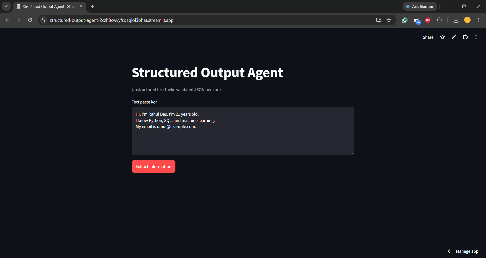

# Structured Output Agent

Unstructured text ke validated JSON e convert kore. LLM field gulo extract kore,
Pydantic schema diye check hoy, ar fail hole validation error shoho maximum 3 bar retry kore.
Sob attempt fail hole clear error dey, fake output dey na.



## Pipeline

User input -> LLM extraction -> JSON parsing -> Schema validation -> Error-correction retry -> Valid JSON or clear failure

## Tech stack

Python, Pydantic, Groq API, Streamlit, pytest

## Setup

```bash
git clone https://github.com/mrrohan4321/structured-output-agent.git
cd structured-output-agent
python -m venv .venv
.venv\Scripts\activate
pip install -r requirements.txt
```

Project root e `.env` file banao:

```
GROQ_API_KEY=your-key-here
```

Key nite: https://console.groq.com/keys

## Run

```bash
streamlit run app.py
```

## Test

```bash
pytest
```

Tests e real LLM call hoy na, fake LLM use kora hoy.

## Project structure

| File | Kaj |
|---|---|
| `schemas.py` | Pydantic `ContactProfile` (extra fields forbidden) |
| `validator.py` | JSON parsing ar validation |
| `agent.py` | LLM call ar bounded retry loop |
| `app.py` | Streamlit UI |
| `tests/test_agent.py` | Automated tests |

## Example

Input:

```
Hi, I'm Rahul Das. I'm 21 years old.
I know Python, SQL, and machine learning.
My email is rahul@example.com.
```

Output:

```json
{
  "name": "Rahul Das",
  "age": 21,
  "skills": ["Python", "SQL", "Machine Learning"],
  "email": "rahul@example.com"
}
```

## Known limitations

- Schema fixed (`name`, `age`, `skills`, `email`). Notun field lagle `schemas.py` ar prompt edit korte hobe.
- Validator structure check kore, information er satyota na. LLM bhul information dileo schema pass korte pare.
- Free Groq tier e rate limit ache.